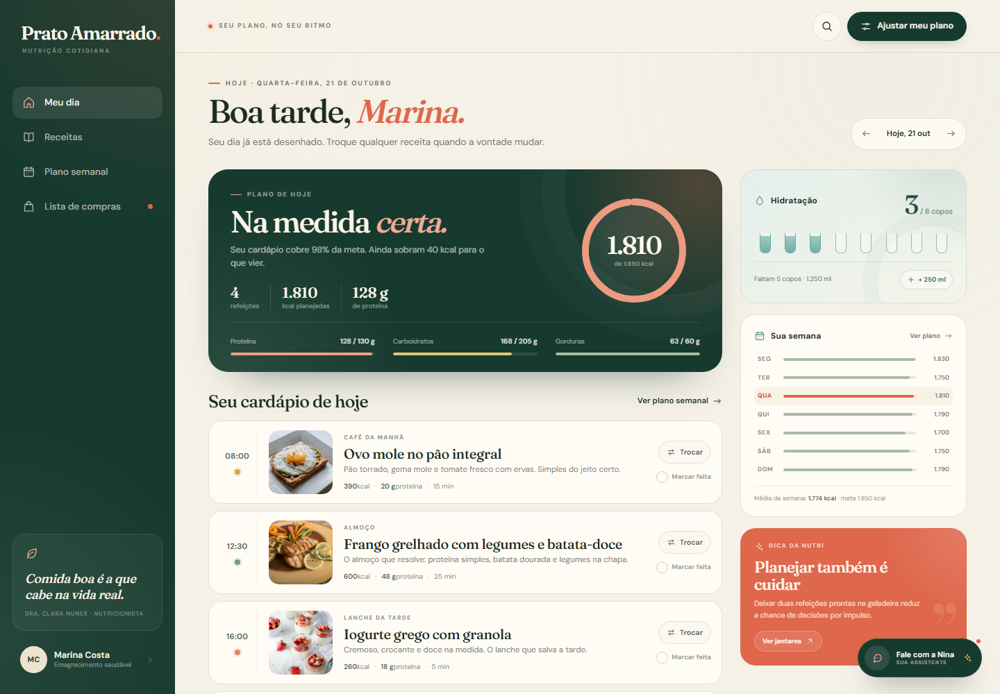
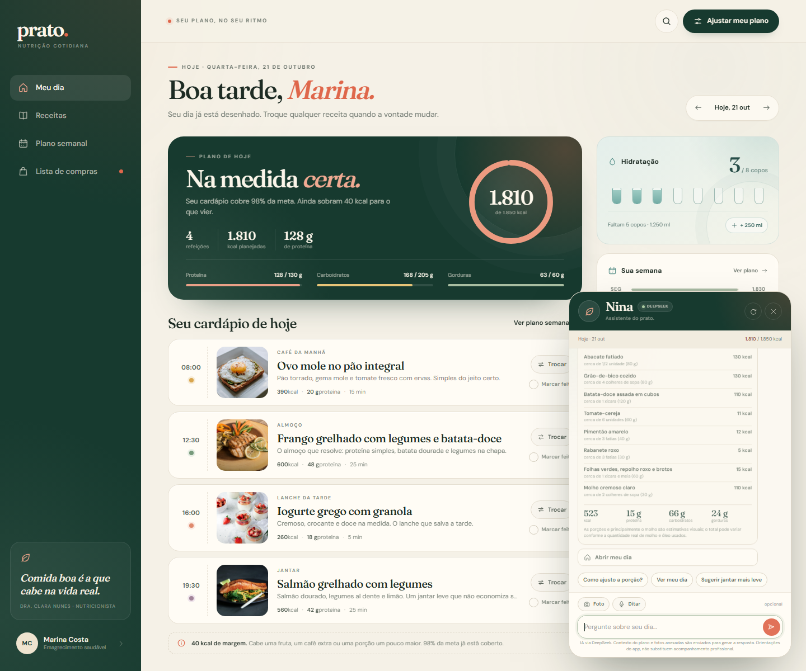
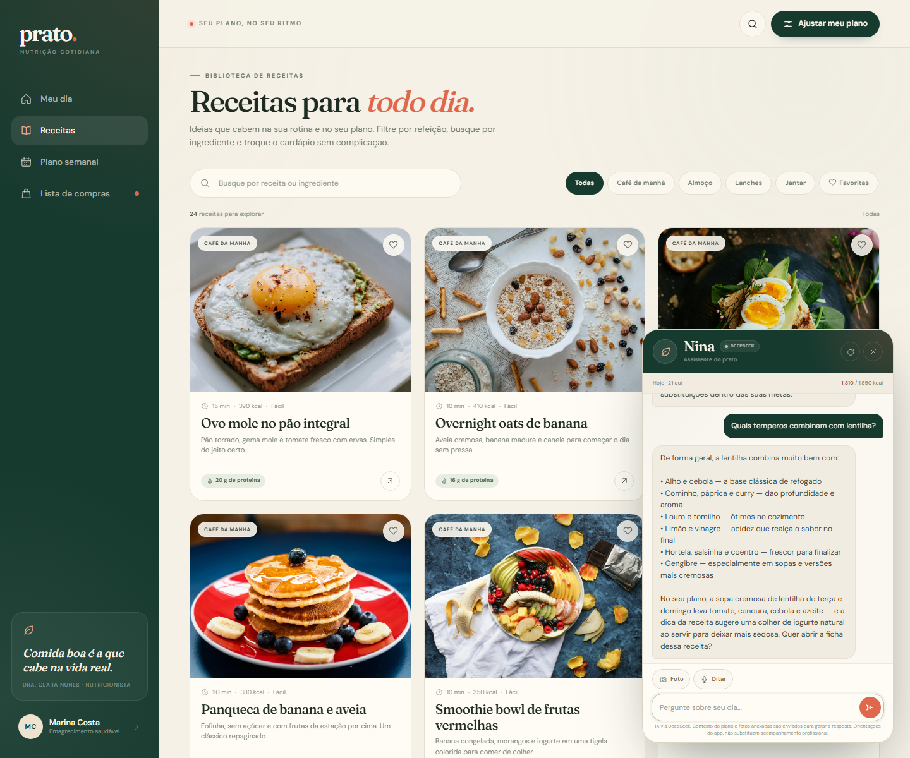
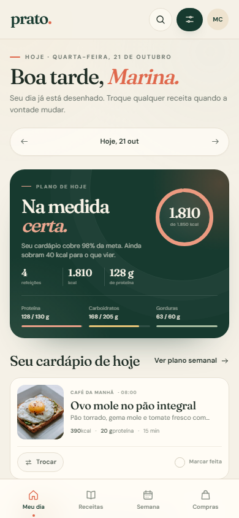
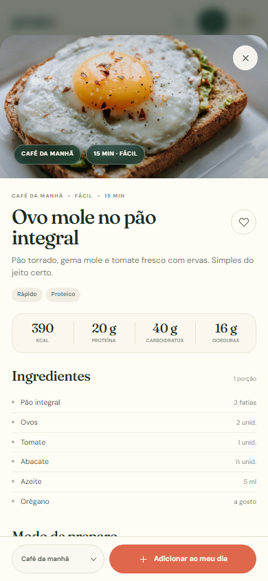
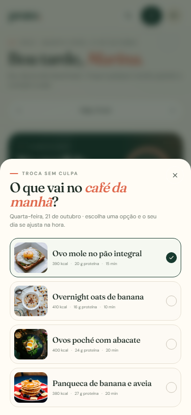
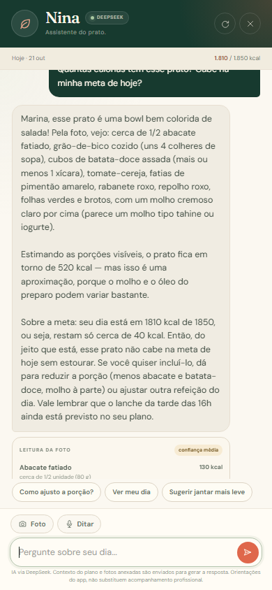

# prato.

[](https://github.com/jorgealberto188-creator/prato-amarrado/actions/workflows/check.yml)

Aplicativo web de nutrição cotidiana com plano diário, troca de receitas em cada refeição, lista de compras gerada a partir do cardápio e a **Nina**, uma assistente conversacional integrada.

**Repositório:** [github.com/jorgealberto188-creator/prato-amarrado](https://github.com/jorgealberto188-creator/prato-amarrado)



## Como abrir

### Com a API do DeepSeek (recomendado)

1. Crie uma chave em [platform.deepseek.com/api_keys](https://platform.deepseek.com/api_keys).
2. Abra o arquivo `.env` que já está na pasta e preencha `DEEPSEEK_API_KEY=...`.
3. Inicie o servidor local:
   - Windows: execute `start.cmd`;
   - ou no terminal: `node server.js`.
4. Abra **http://127.0.0.1:4173**.

Depois de alterar o `.env` ou o `server.js`, reinicie o servidor para a Nina carregar as alterações.

A chave fica somente no servidor local. O navegador conversa com `/api/chat`, e é o servidor que chama a API do DeepSeek — a chave nunca é enviada ao front-end.

### Sem servidor (modo local)

Também é possível abrir **`index.html`** diretamente no navegador. Se o servidor local estiver rodando em `http://127.0.0.1:4173`, a página tenta se conectar automaticamente à API, mesmo aberta por `file://`; a etiqueta do chat muda para **DeepSeek**. Sem servidor, a Nina usa o motor local de intenções, com as funções do app e sem depender de internet. Fontes e imagens estão incluídas em `assets`.

Para usar todos os recursos — especialmente microfone e foto — prefira abrir pelo endereço do servidor: **http://127.0.0.1:4173**.

## API do DeepSeek

- Modelo padrão: `deepseek-flash`, configurável em `DEEPSEEK_MODEL`.
- Endpoint usado: `POST https://api.deepseek.com/chat/completions`, no formato compatível com OpenAI.
- Saída em JSON estruturado, com mensagem, ações do app e sugestões rápidas.
- A Nina recebe apenas o contexto necessário para responder: refeições do dia, metas, água, compras e catálogo de receitas.
- Se a API falhar, a Nina informa que não conseguiu responder em vez de inventar; falhas temporárias são repetidas automaticamente. Sem chave configurada, o app usa o modo local.
- No cabeçalho do chat, a etiqueta **DeepSeek** indica que a IA está ativa; **modo local** indica que o motor local está respondendo.
- A análise de fotos usa a visão do `deepseek-flash`.
- Limite de 30 mensagens por minuto por cliente.
- O uso da API é cobrado pela DeepSeek conforme os preços da plataforma.
- Referências: [primeira chamada](https://api-docs.deepseek.com/), [JSON Output](https://api-docs.deepseek.com/guides/json_mode/) e [Vision](https://api-docs.deepseek.com/guides/vision/).

## O que ele faz

- **Meu dia**: resumo de calorias e macros, cardápio com quatro refeições, registro de refeição feita e controle de hidratação.
- **Trocar receitas**: cada refeição oferece seis opções. Ao trocar, o total de calorias, proteínas, carboidratos e gorduras é recalculado na hora.
- **Receitas**: biblioteca com 24 receitas, busca por nome ou ingrediente, filtros por refeição e favoritas. Cada receita tem ingredientes, modo de preparo, informação nutricional e dica.
- **Plano semanal**: visão dos sete dias, médias da semana e geração de uma nova variação do cardápio com um clique.
- **Lista de compras**: ingredientes da semana somados automaticamente, visão do dia ou da semana, itens comprados e adição de itens extras.
- **Perfil**: nome, objetivo, meta calórica e meta de água. As metas ficam salvas no próprio navegador.
- **Navegação por data**: consulte e edite dias anteriores ou seguintes.
- **Nina, a assistente**: chatbot contextual que orienta a navegação e executa ações dentro do app.
- **Voz e foto no chat**: ditado para quem não quer ou não pode digitar e análise visual de uma refeição a partir de uma foto.

## Assistente Nina

A Nina acompanha o dia selecionado e conhece o cardápio, as metas, a hidratação e a lista de compras. Além dos dados do app, ela responde dúvidas gerais de **nutrição, dietética e gastronomia** — como calorias de um alimento isolado, substituições, temperos, técnicas e ideias de preparo. Essas respostas são educativas e deixam claro quando o valor é uma estimativa.

Ela pode:

- explicar calorias, macros e o que está em cada refeição;
- sugerir receitas por refeição, ingrediente, tempo ou preferência (leve, proteica, vegetariana, doce);
- **trocar uma refeição direto pelo chat**, recalculando o dia;
- registrar um copo de água;
- abrir a lista de compras, o plano semanal ou o perfil;
- orientar quem está começando a usar o aplicativo;
- receber perguntas por **voz**;
- analisar uma **foto de refeição** e estimar alimentos, porções, calorias e macros;
- relacionar a foto com as metas e com o restante do dia.

Exemplos de pedidos: “o que tem no almoço?”, “quero algo leve para o jantar”, “quero trocar o lanche”, “quantas calorias faltam?”, “quantas calorias tem uma batata inglesa grande?”, “o que combina com lentilha?” e “como substituir manteiga em um bolo?”.

### Voz

No rodapé do chat, toque em **Ditar** e fale. O texto reconhecido aparece no campo para você revisar antes de enviar. O ditado usa a Web Speech API do próprio navegador (Chrome/Edge) e pode exigir internet para o serviço de voz do navegador. O áudio não é gravado pelo servidor do prato.

### Foto

Toque em **Foto**, escolha ou tire uma foto da refeição e envie. A Nina usa a visão do `deepseek-flash` para identificar os alimentos visíveis e montar uma estimativa. O resultado mostra os itens, as porções, a confiança da leitura e os totais de calorias, proteína, carboidratos e gordura.



A estimativa é visual: molhos, óleo e porções escondidas podem mudar bastante os valores. A imagem é processada em memória no servidor e não é gravada em disco; ela é enviada à DeepSeek para a análise.



Com a API configurada, as respostas são geradas pelo modelo `deepseek-flash` e retornam junto com ações estruturadas (abrir uma receita, trocar uma refeição, registrar água etc.). Sem chave, o motor local em `chatbot.js` assume automaticamente.

A Nina recebe o contexto completo do app — ingredientes e quantidades das 24 receitas, modo de preparo, plano dos sete dias, lista de compras e metas — e é instruída a não inventar dados do app. Para perguntas gerais, ela usa conhecimento nutricional e culinário, com estimativas sinalizadas. As ações retornadas pela IA são validadas contra o catálogo antes de chegar à interface. Se a DeepSeek falhar, a resposta é explícita em vez de usar uma suposição; tentativas temporárias são repetidas automaticamente.

**Privacidade:** ao usar a API, o contexto do plano — e a foto, quando anexada — é enviado ao servidor local e deste para a DeepSeek para gerar a resposta. O áudio do ditado é tratado pelo serviço de voz do navegador, não pelo servidor do app. No modo local, nada relacionado ao texto sai do navegador. A chave nunca é exposta ao cliente.

## Estrutura

```text
index.html        estrutura e ícones
styles.css        identidade visual e layout responsivo
data.js           receitas, refeições, metas e dicas
chatbot.js        motor local de intenções e respostas
app.js            estado, navegação, chat e interações
server.js         servidor local, proxy seguro da API e arquivos estáticos
start.cmd         inicialização no Windows
package.json      scripts npm e metadados do projeto
.env              sua chave local (não versionar)
.env.example      modelo das variáveis de ambiente
.github/          workflow de verificação contínua
assets/           fotografias e fontes locais
screenshots/      capturas do aplicativo
```

## Tecnologias

- HTML, CSS e JavaScript puro no front-end, sem bundler.
- Node.js 20+ com `http` nativo no servidor.
- DeepSeek Chat Completions para texto e visão.
- Web Speech API para ditado no navegador.
- `localStorage` para perfil, planos, água e compras.
- Nenhuma dependência npm.

## Publicação

O repositório pode ser publicado normalmente no GitHub. O workflow em `.github/workflows/check.yml` verifica a sintaxe a cada push e falha se o `.env` for commitado.

Importante: **GitHub Pages não executa `server.js`**. Em uma página estática do GitHub Pages, o app funciona em modo local, sem a Nina completa. Para manter a IA, o ditado e a análise de fotos, publique `server.js` em um serviço que rode Node (Render, Railway, Fly.io, VPS ou máquina local) e configure `DEEPSEEK_API_KEY` nas variáveis de ambiente desse serviço.

## Observações

- O plano e o perfil ficam em `localStorage`; não há cadastro nem banco de dados.
- A chave da DeepSeek nunca deve ser colocada no front-end, no `index.html` ou em um repositório. Use o `.env`, que está no `.gitignore`.
- A Nina oferece orientações do próprio app e não substitui acompanhamento nutricional.
- Calorias e macronutrientes são estimativas por porção e o conteúdo é ilustrativo; não substitui acompanhamento profissional.
- Fotografias de alimentos: [Unsplash](https://unsplash.com). Tipografia: Fraunces e DM Sans (Google Fonts, licença SIL OFL).

### Mobile

| Meu dia | Receita | Troca |
| --- | --- | --- |
|  |  |  |

| Nina no mobile |
| --- |
|  |
